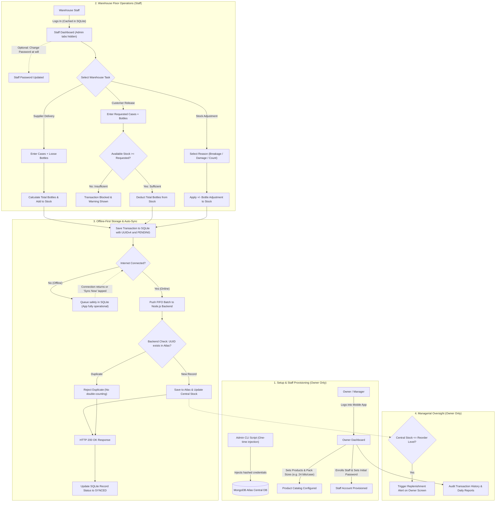

# Offline-First Soft Drinks Inventory System

An offline-first inventory management app for a soft drinks wholesale business in Gusa. Staff can record deliveries, releases, and stock adjustments in cases and individual bottles, even without internet. Pending transactions are synchronized to a central database when a connection returns.

## Tech Stack

| Layer | Technology |
|---|---|
| Mobile app | Expo and React Native (Android) |
| Local database | SQLite |
| Backend API | Node.js and Express |
| Central database | MongoDB Atlas |

## System Flow & How It Works

### Operational Architecture

### End-to-End Operational Walkthrough

1. **Initial Provisioning & Catalog Setup (Admin CLI)**:
   - The business owner runs a secure CLI injection script (`npm run seed:admin`) to provision the initial Owner/Manager account directly into MongoDB Atlas with salted bcrypt hashing.
   - The owner logs into the mobile app and configures product packaging specifications (brand name, bottle size in ml/L, units per case, and minimum reorder alert thresholds).
2. **Staff Onboarding & Role Restriction (Owner)**:
   - The owner navigates to **Staff Enrollment** to provision new warehouse employees with a unique username and initial password. Public registration is strictly disabled.
   - Upon initial login, staff credentials are encrypted and cached in local SQLite for offline access. Staff can change their password at will under **Settings**.
   - Strict Role-Based Access Control (RBAC) hides all management interfaces (Product Management, User Management, Staff Enrollment, and Reports) from the staff interface.
3. **Recording Warehouse Transactions (Staff - 100% Offline Capable)**:
   - When a delivery arrives from a supplier, staff enter the case count and loose bottle count (e.g., 50 cases and 12 loose bottles of Coca-Cola 1.5L). The app automatically calculates total bottle count based on units per case.
   - When releasing stock to a retail customer, the app validates requested quantities against available SQLite stock in real time. If requested stock exceeds inventory, the transaction is immediately blocked to prevent negative stock.
   - In case of bottle breakage or transport damage, staff record a stock adjustment selecting a mandatory reason (`breakage`, `damage`, `loss`, or `count_correction`).
4. **Local SQLite Persistence & Immutable Queue**:
   - Each transaction generates a unique UUIDv4, commits immediately to local SQLite, and is stored in the sync queue table marked as `PENDING`.
   - The warehouse workflow never stutters, lags, or blocks if the mobile device loses internet connectivity or WiFi coverage.
5. **Background Sync & Idempotent Processing**:
   - The app monitors connectivity via NetInfo. As soon as the device detects an active internet connection (or when the user taps **Sync Now**), the queue transmits pending transactions in FIFO batches to the Node.js API.
   - The backend checks each transaction UUID against MongoDB Atlas to enforce strict idempotency—preventing duplicate stock counts if a connection dropped mid-request.
   - On confirmation (HTTP 200), the app marks local records as `SYNCED`. If network fails mid-sync, items remain `FAILED` or `PENDING` with full retry support.
6. **Owner Alerts & Inventory Reconciliation**:
   - If central stock levels fall below the defined reorder threshold, the owner's dashboard immediately highlights a replenishment alert with the exact deficit bottle count.
   - The owner can audit complete, tamper-proof transaction histories and export movement summaries filtered by date and transaction type.

## Core Assumptions & System Boundaries (Non-Goals)

To preserve architectural clarity and focus on warehouse stock movement, the system operates under the following explicit project boundaries:

1. **Pure Volume-Based Stock Tracking**:
   - The system tracks physical product units (cases and loose bottles).
   - Point-of-Sale (POS) capabilities, customer retail pricing, margins, credit ledgers (*utang*), and payment gateway processing are explicitly **out of scope**.
2. **Empty Bottle & Crate (*Embalaje*) Scope**:
   - Returnable Glass Bottle (RGB) shell/crate and empty bottle deposit accounting is **out of scope**.
   - The system strictly tracks saleable beverage inventory.
3. **Single-Depot Wholesale Deployment**:
   - Designed for a single wholesale distribution warehouse in Gusa, Cagayan de Oro.
   - Multi-warehouse routing, inter-branch logistics transfers, and multi-tenant isolation are non-goals for this version.
4. **Android-First Handheld Deployment**:
   - Target clients are warehouse-floor Android devices running Android 10 (API level 29) through Android 14 (API level 34).
5. **Initial Online Setup Requirement (Device Hydration)**:
   - A newly installed device must be connected online for its initial login to authenticate the user and hydrate the local SQLite database with active product definitions before offline operation begins.

## Requirements

### Functional Requirements (FR)

| ID | Requirement |
|---|---|
| FR1 | The system shall provide a secure administrative bootstrap/injection script (CLI) to provision an initial Owner/Manager account directly into MongoDB Atlas with salted bcrypt password hashing, ensuring administrative credentials are never stored in or parsed from application environment variables (`.env`). |
| FR2 | The mobile application shall authenticate user credentials against the backend API within 2 seconds when online, returning a signed JWT token containing the user ID, username, and assigned role (`staff` or `owner/manager`). |
| FR3 | The mobile application shall cache hashed user credentials and roles securely in local SQLite upon each successful online login, allowing users to authenticate and access the app offline with zero network connectivity. |
| FR4 | The system shall enforce strict Role-Based Access Control (RBAC) across both mobile navigation and backend API endpoints: staff users shall be granted access strictly to operational screens (Dashboard, Delivery, Release, Adjustment, Sync Queue, Catalog, Settings), while administrative screens (Product Management, User Management, Staff Enrollment, Reports) and their navigation elements shall be completely hidden and inaccessible to staff. |
| FR5 | The mobile application shall provide a secure logout function that clears local session tokens and cached in-memory state within 500 milliseconds, redirecting the user to the Login screen and requiring re-authentication. |
| FR6 | The system shall restrict account creation exclusively to the Owner/Manager, disabling public self-registration; only an authenticated Owner/Manager can enroll new staff and provision their initial credentials (full name, unique username, initial password of at least 6 characters, and assigned role) into MongoDB Atlas and local SQLite. |
| FR7 | The system shall allow an owner/manager to view the complete user list and toggle the active status of any staff account (`is_active = false`), immediately revoking their login permissions while preserving all historical transactions associated with their user ID. |
| FR8 | The system shall allow an owner/manager to add a new soft drink product with mandatory attributes: brand name, product name, bottle size in ml/L, units per case (integer >= 1), and an initial reorder alert threshold (integer >= 0). |
| FR9 | The system shall allow an owner/manager to update product specifications (brand name, bottle size, reorder threshold) or deactivate a product (`is_active = false`), preventing deactivated products from appearing in transaction dropdowns while preserving historical transaction records. To prevent historical inventory audit corruption, the `units_per_case` pack size attribute shall remain immutable once transactions have been recorded for that product. |
| FR10 | The system shall allow an owner/manager to define and update a minimum stock reorder threshold (in total bottles) for each individual product. |
| FR11 | The system shall record incoming supplier deliveries by accepting case quantity (integer >= 0) and loose bottle quantity (integer >= 0), validating that `(cases + loose_bottles) > 0`, calculating the total added bottles, and incrementing local product stock. |
| FR12 | The system shall record customer release transactions by accepting case quantity (integer >= 0) and loose bottle quantity (integer >= 0), validating that `(cases + loose_bottles) > 0`, deducting total bottles from local stock, and assigning a unique UUID. |
| FR13 | The system shall evaluate outgoing customer release requests against currently available local stock and immediately block any transaction where `requested_total_bottles > available_stock_bottles`, displaying an alert message and preventing record creation. |
| FR14 | The system shall record stock adjustment transactions (positive or negative adjustments in cases and bottles) requiring the selection of a mandatory reason (`breakage`, `damage`, `loss`, or `count_correction`) and an optional remarks field, adjusting local inventory accordingly. |
| FR15 | The system shall compute single-bottle inventory totals using `total_bottles = (cases * units_per_case) + loose_bottles` and format all stock displays throughout the app as `X cases and Y bottles` where `cases = floor(total_bottles / units_per_case)` and `remaining_bottles = total_bottles % units_per_case`. |
| FR16 | The mobile application shall execute all read, write, and stock calculation queries against the local SQLite database first, enabling full operational functionality without an active network connection. |
| FR17 | The system shall assign an immutable UUIDv4 to every created transaction and immediately insert the record into a local sync queue table with status `PENDING` and a UTC creation timestamp. |
| FR18 | The system shall detect network availability changes via NetInfo and automatically transmit pending transactions in FIFO order to the backend API within 5 seconds of network restoration. |
| FR19 | The system shall provide a manual 'Sync Now' action on the Sync Queue screen allowing the user to initiate an immediate synchronization of all `PENDING` and `FAILED` transactions with visual progress feedback. |
| FR20 | The backend API shall validate transaction payloads against schema rules and enforce idempotency by querying incoming UUIDs against MongoDB Atlas; existing UUIDs shall be rejected as duplicates with HTTP 200/409 without double-counting stock. |
| FR21 | Upon successful validation of non-duplicate transactions, the backend API shall persist the transaction record in MongoDB Atlas and atomically update the centralized product inventory. |
| FR22 | Upon receiving confirmation from the backend API, the mobile app shall mark the local transaction as `SYNCED`; if the sync fails due to HTTP 4xx/5xx or timeout, the app shall mark the status as `FAILED`, store the error description, and retain the item in the sync queue for subsequent retry. |
| FR23 | Upon a successful connection to the backend, the mobile app shall fetch the latest product definitions and centralized stock adjustments from MongoDB Atlas and update the local SQLite database to reconcile multi-device changes. |
| FR24 | The system shall maintain an immutable, append-only transaction history log that cannot be edited or deleted via any UI or API endpoint, recording transaction UUID, timestamp, user ID, device ID, transaction type, cases, loose bottles, and resulting stock. |
| FR25 | The system shall generate inventory reports filterable by date range and transaction type, displaying cumulative stock received, released, and adjusted per product over the selected period. |
| FR26 | The system shall generate a replenishment report listing all active products whose `total_bottles <= reorder_level_bottles`, displaying the deficit quantity needed to reach safe stock levels. |
| FR27 | The system shall provide a real-time search and filter feature on the Product Catalog and Dashboard screens, filtering products by brand name or product name with search results updating within 300 milliseconds of user input. |
| FR28 | The system shall allow staff to log in using their initial administrator-created credentials and provide a self-service password change capability (via Settings/Profile) allowing staff to change their password at will upon validating their current password. |
| FR29 | The system shall allow an authenticated Owner/Manager to reset any staff member's password to a new temporary credential via the User Management screen to resolve forgotten password lockouts. |
| FR30 | The system shall allow staff to record an optional Customer / Destination identifier or Receipt number during stock release, and an optional Supplier Waybill / Delivery Receipt (DR) reference during delivery for wholesale audit tracing. |
| FR31 | Upon establishing a network connection, the mobile application shall execute a downstream synchronization query (`GET /api/sync/downstream`) to fetch newly added/updated products and authoritative centralized stock balances from MongoDB Atlas, reconciling multi-device changes in local SQLite without duplicating local transactions. |

### Non-Functional Requirements (NFR)

| ID | Category | Requirement |
|---|---|---|
| NFR1 | Availability | The mobile application shall support 100% of core transaction recording (deliveries, releases, adjustments) and catalog lookups locally in SQLite with zero network connectivity. |
| NFR2 | Reliability | The system shall ensure zero transaction data loss in the event of sudden application termination, phone reboot, or network interruption during a sync transmission through SQLite atomic transactions and Write-Ahead Logging (WAL). |
| NFR3 | Data Integrity | The backend API shall guarantee 100% idempotent transaction processing by enforcing unique index constraints on transaction UUIDs, ensuring stock counts are never modified more than once even if the same transaction payload is transmitted multiple times. |
| NFR4 | Consistency | Product stock totals between the local SQLite database and MongoDB Atlas shall achieve exact consistency within 5 seconds of completing an error-free batch synchronization cycle. |
| NFR5 | Performance | The mobile application shall record a transaction to local SQLite and update the stock display in the user interface in under 500 milliseconds (and under 2 seconds under a maximum load of 10,000 local records). |
| NFR6 | Performance | The sync engine and backend API shall process and synchronize a batch of 100 pending transactions within 30 seconds (maximum 60 seconds) over a cellular or Wi-Fi connection with at least 1 Mbps uplink. |
| NFR7 | Security | All user passwords shall be hashed using bcrypt (minimum 10 salt rounds) prior to persistence, and all backend API endpoints and mobile screens shall reject unauthorized requests lacking a valid role-matching JWT token with HTTP 403 Forbidden. |
| NFR8 | Security | All network communication between the mobile app and backend API shall be encrypted using TLS 1.3 (HTTPS), and no central database connection URIs or administrative API secrets shall be hardcoded or bundled inside the mobile client APK. |
| NFR9 | Usability | The delivery and release forms shall allow a trained user to complete an entry in 4 or fewer taps/inputs within 15 seconds, providing numeric keypad defaults and dual input fields for cases and bottles. |
| NFR10 | Compatibility | The mobile client shall install, launch in under 3 seconds, and render all screens without layout breakage or crashes on Android devices running Android 10 (API level 29) through Android 14 (API level 34) across standard screen sizes (5.0 to 6.8 inches). |
| NFR11 | Maintainability | The application code shall be organized into decoupled modules (mobile UI, SQLite repositories, sync engine, Express controllers, Mongoose models) maintaining automated unit and integration test coverage for calculation and sync logic. |
| NFR12 | Auditability | Every transaction record shall capture immutable audit metadata—including initiating `user_id`, `device_id` (UUID), transaction type, timestamp in ISO 8601 UTC format, and sync status—persisted immutably across SQLite and MongoDB. |
| NFR13 | Concurrency Resilience | In the event of multi-device concurrent offline releases exceeding total warehouse stock, the backend API shall persist all valid offline transactions, compute the deficit balance, and flag the transaction record with discrepancy status `CONCURRENCY_DEFICIT`, triggering an immediate visual alert on the Owner Dashboard for physical audit reconciliation. |

### Screen Requirements

| Screen | Description | Status / Path |
|---|---|---|
| Login Screen | Allows staff and owner/manager to log in using their credentials and role; authenticates online with backend JWT or offline with cached SQLite credentials, and enforces role-based navigation and permissions (FR1, FR2, FR3, FR4, NFR7). | Planned (`mobile/src/screens/LoginScreen.tsx`) |
| Dashboard / Home Screen | Displays current inventory summary (cases and loose bottles), device network/sync status indicator, low-stock replenishment alerts, concurrency deficit warnings, real-time product search, and quick-action shortcuts for recording transactions (FR15, FR16, FR18, FR26, FR27, NFR1, NFR5, NFR9, NFR13). | Planned (`mobile/src/screens/DashboardScreen.tsx`) |
| Record Delivery Screen | Fast-entry form for recording incoming stock from suppliers in cases and loose bottles with optional Supplier DR / Waybill reference; automatically calculates total bottles, saves to local SQLite with a UUID, and queues for backend synchronization (FR11, FR15, FR16, FR17, FR30, NFR1, NFR5, NFR9, NFR12). | Planned (`mobile/src/screens/DeliveryScreen.tsx`) |
| Record Release Screen | Form for recording stock released to customers in cases and bottles with optional Customer / Destination or Receipt reference; validates against available inventory in real time, rejects releases exceeding stock with an alert dialog, and logs the transaction with a UUID (FR12, FR13, FR15, FR16, FR17, FR30, NFR1, NFR5, NFR9). | Planned (`mobile/src/screens/ReleaseScreen.tsx`) |
| Stock Adjustment Screen | Form to record inventory changes due to breakage, damage, loss, or count corrections in cases and bottles; requires a mandatory reason and saves an immutable adjustment record with a UUID (FR14, FR15, FR16, FR17, NFR1, NFR5, NFR9, NFR12). | Planned (`mobile/src/screens/AdjustmentScreen.tsx`) |
| Product Catalog Screen | Searchable and filterable list of all soft drink products showing current stock (cases and remaining bottles), bottle size, bottles per case, reorder level, and active/inactive status (FR8, FR9, FR10, FR15, FR16, FR27, NFR1). | Planned (`mobile/src/screens/ProductListScreen.tsx`) |
| Product Management Screen | Owner-only form to add, edit, or deactivate products, configure brand names, bottle sizes, immutable bottles per case (pack size), and set individual product reorder thresholds (FR8, FR9, FR10, NFR7). | Planned (`mobile/src/screens/ProductFormScreen.tsx`) |
| Transaction History Screen | Read-only, immutable audit trail of all transactions (deliveries, releases, adjustments) with filters by date, type, product, and staff; displays transaction UUID, user, device ID, customer/supplier reference tag, and timestamp (FR24, FR30, NFR1, NFR2, NFR12). | Planned (`mobile/src/screens/TransactionHistoryScreen.tsx`) |
| Sync Queue & Status Screen | Displays network connectivity status, pending/synced/failed transaction counts, downstream reconciliation triggers, detailed failure reasons with retry triggers, and a manual sync button to push offline SQLite records to MongoDB Atlas (FR17, FR18, FR19, FR22, FR23, FR31, NFR2, NFR3, NFR4, NFR6). | Planned (`mobile/src/screens/SyncQueueScreen.tsx`) |
| Reports & Analytics Screen | Generates reports for current stock levels, stock movement logs filtered by date range, and a replenishment list of items that have reached or fallen below their reorder level (FR25, FR26, NFR1). | Planned (`mobile/src/screens/ReportsScreen.tsx`) |
| User Management Screen | Owner-only screen to view, search, deactivate existing accounts, reset forgotten staff passwords to new temporary credentials, as well as navigate to the staff enrollment screen (FR1, FR4, FR7, FR29, NFR7). | Planned (`mobile/src/screens/UserManagementScreen.tsx`) |
| Staff Enrollment Screen | Owner-only screen/form to enroll and register a newly hired staff member or manager into the business; captures full name, username, initial temporary password, and role assignment (`staff` or `owner/manager`) (FR6, NFR7). | Planned (`mobile/src/screens/StaffEnrollmentScreen.tsx`) |
| Settings / Profile Screen | Displays logged-in user profile, role, device ID, local database diagnostics, sync preferences, provides self-service password changes, and provides a secure logout function (FR2, FR5, FR28, NFR7, NFR8, NFR12). | Planned (`mobile/src/screens/SettingsScreen.tsx`) |

## Data Handling Rules

- Stock is stored in bottles: `total_bottles = (cases x units_per_case) + loose bottles`. It is displayed as cases and remaining bottles.
- Every transaction gets a UUID on the device when it is created, so a retried upload is never counted twice.
- Records are never deleted or edited. Corrections are entered as new adjustment transactions.

## Role-Based Access Control (RBAC) Table

The system defines two primary roles: **Staff** and **Owner / Manager** (FR4, NFR7). Access to screens and operational capabilities is strictly partitioned according to these roles:

| Module / Screen | Feature / Permission | Staff | Owner / Manager | Reference |
|---|---|:---:|:---:|---|
| **Authentication & Profile** | Log in with credentials and role (online/offline) | ✅ | ✅ | FR2, FR3, Login Screen |
| | View profile, device ID, and diagnostics | ✅ | ✅ | Settings Screen |
| | Change personal password at will | ✅ | ✅ | FR28, Settings Screen |
| | Log out and clear session tokens | ✅ | ✅ | FR5, Settings Screen |
| **Dashboard & Catalog** | View dashboard summary & stock alerts | ✅ | ✅ | FR15, FR16, FR26, Dashboard Screen |
| | Search and filter product catalog & pack sizes | ✅ | ✅ | FR15, FR27, Product Catalog Screen |
| **Inventory Transactions** | Record deliveries from suppliers (cases & bottles) | ✅ | ✅ | FR11, Delivery Screen |
| | Record releases to customers with real-time stock check | ✅ | ✅ | FR12, FR13, Release Screen |
| | Record stock adjustments with required reason | ✅ | ✅ | FR14, Adjustment Screen |
| **Sync & Offline Queue** | View sync queue status (pending / synced / failed) | ✅ | ✅ | FR17, FR22, Sync Queue Screen |
| | Trigger manual sync of offline transactions | ✅ | ✅ | FR18, FR19, Sync Queue Screen |
| **Audit & History** | View immutable transaction history & audit logs | ✅ | ✅ | FR24, Transaction History Screen |
| **Reports & Analytics** | View current stock level & movement reports by date | ❌ *(Hidden)* | ✅ | FR4, FR25, Reports Screen |
| | View replenishment lists for low-stock items | ❌ *(Hidden)* | ✅ | FR4, FR26, Reports Screen |
| **Product Management** | Add, edit, and deactivate products | ❌ *(Hidden)* | ✅ | FR4, FR8, FR9, Product Management Screen |
| | Configure brand, bottle size, and pack size (bottles/case) | ❌ *(Hidden)* | ✅ | FR4, FR8, FR9, Product Management Screen |
| | Set and update reorder thresholds per product | ❌ *(Hidden)* | ✅ | FR4, FR10, Product Management Screen |
| **User Administration** | Inject initial Owner/Manager account via secure CLI script | ❌ *(Hidden)* | ✅ | FR1, Admin Injection Script |
| | Exclusively enroll newly hired staff & assign initial credentials (no public signup) | ❌ *(Hidden)* | ✅ | FR4, FR6, Staff Enrollment Screen |
| | View, edit, and deactivate staff & manager accounts | ❌ *(Hidden)* | ✅ | FR4, FR7, User Management Screen |
| | Assign roles and manage RBAC access permissions | ❌ *(Hidden)* | ✅ | FR4, FR6, FR7, User Management Screen |
