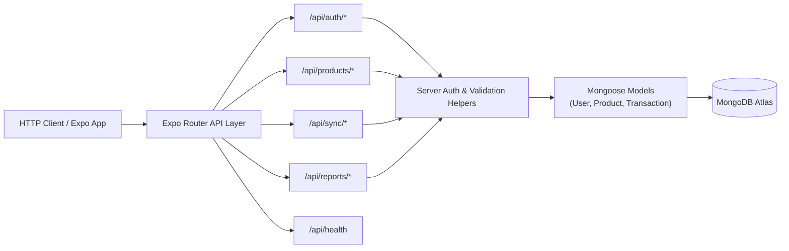

# Phase 2 Implementation Plan: Cloud API Routes & MongoDB Atlas Integration

> [!IMPORTANT]
> **Goal of Phase 2:** Build and verify all server-side API routes using **Expo Router API Routes (`+api.ts`)** running on Node.js and backed by **MongoDB Atlas**. By the end of this phase, every backend endpoint specified in the README (Auth, Products, Batch Sync, Downstream Sync, Reports) can be tested and verified with HTTP requests.

---

## 1. What YOU Need to Do (Prerequisites for the User)

Before the server endpoints can talk to MongoDB Atlas, you need an active database connection:

1. **Create `mobile/.env`**:
   Copy [`mobile/.env.example`](file:///D:/softdrinks-app/softdrinks-inventory-system/mobile/.env.example) to `mobile/.env`:
   ```bash
   cp mobile/.env.example mobile/.env
   ```
2. **Fill in your MongoDB Atlas URI & Secret**:
   Open `mobile/.env` and supply your actual credentials:
   ```env
   MONGODB_URI=mongodb+srv://<db_user>:<db_password>@cluster0.xxxxx.mongodb.net/softdrinks_db?retryWrites=true&w=majority
   JWT_SECRET=your_super_secret_jwt_key_here
   EXPO_PUBLIC_API_URL=http://localhost:8081/api
   ```
3. **Execute the One-Time Admin Seeder (FR1)**:
   In your terminal, navigate to `mobile/` and run:
   ```bash
   cd mobile
   npm run seed:admin
   ```
   Follow the prompts to create your initial Owner/Manager account directly in MongoDB Atlas.

---

## 2. API Routes to Build (Expo Router `+api.ts`)

All endpoints will be created under `mobile/src/app/api/` using standard web `Request` and `Response` objects:



### Module Breakdown

| Route Path | File Location | Method | Access | Purpose | Requirements |
|---|---|:---:|:---:|---|---|
| `/api/health` | `src/app/api/health+api.ts` | `GET` | Public | Connectivity and DB ping | System health |
| `/api/auth/login` | `src/app/api/auth/login+api.ts` | `POST` | Public | Validates bcrypt password, returns JWT | FR2, NFR7 |
| `/api/auth/change-password` | `src/app/api/auth/change-password+api.ts` | `POST` | Authenticated | Staff/Owner personal password change | FR28 |
| `/api/auth/admin/enroll` | `src/app/api/auth/admin/enroll+api.ts` | `POST` | Owner Only | Provisions new staff account | FR6 |
| `/api/auth/admin/reset-password` | `src/app/api/auth/admin/reset-password+api.ts` | `POST` | Owner Only | Resets forgotten staff password | FR29 |
| `/api/auth/users` | `src/app/api/auth/users/index+api.ts` | `GET` | Owner Only | Returns user list | FR7 |
| `/api/auth/users/:id/status` | `src/app/api/auth/users/[id]/status+api.ts` | `PATCH` | Owner Only | Toggles active status (`is_active`) | FR7 |
| `/api/products` | `src/app/api/products/index+api.ts` | `GET` | Authenticated | Fetches active catalog | FR8 |
| `/api/products` | `src/app/api/products/index+api.ts` | `POST` | Owner Only | Creates new product | FR8, FR10 |
| `/api/products/:id` | `src/app/api/products/[id]+api.ts` | `PATCH` | Owner Only | Updates product (pack size immutable) | FR9, FR10 |
| `/api/sync/batch` | `src/app/api/sync/batch+api.ts` | `POST` | Authenticated | Idempotent FIFO batch upload & stock update | FR20, FR21, NFR3, NFR13 |
| `/api/sync/downstream` | `src/app/api/sync/downstream+api.ts` | `GET` | Authenticated | Pulls changes since timestamp | FR23, FR31 |
| `/api/reports/summary` | `src/app/api/reports/summary+api.ts` | `GET` | Owner Only | Stock movement log by date range | FR25 |
| `/api/reports/replenishment` | `src/app/api/reports/replenishment+api.ts` | `GET` | Owner Only | Deficit items below reorder threshold | FR26 |

---

## 3. Server-Side Middleware & Utilities to Build

Before writing the route handlers, we will create reusable server helpers in `mobile/src/server/middleware/`:

1. **[`src/server/middleware/auth.ts`](file:///D:/softdrinks-app/softdrinks-inventory-system/mobile/src/server/middleware/auth.ts)**:
   - `authenticate(req: Request)`: Extracts `Bearer <token>`, verifies JWT using `JWT_SECRET`, and returns the decoded user payload. Throws 401 if missing/invalid.
   - `requireOwner(user: AuthUser)`: Asserts `user.role === 'owner/manager'`. Throws 403 if staff attempts to access administrative endpoints.
2. **[`src/server/middleware/response.ts`](file:///D:/softdrinks-app/softdrinks-inventory-system/mobile/src/server/middleware/response.ts)**:
   - `jsonOk(data, status = 200)`: Standard JSON success response.
   - `jsonError(message, status = 400, details = null)`: Standard JSON error envelope.

---

## 4. The Critical Idempotent Batch Sync Algorithm (`/api/sync/batch`)

The batch sync handler is the core of data integrity:

```typescript
// Algorithm for each transaction in the incoming batch:
1. Check if Transaction.findOne({ uuid: tx.uuid }) exists.
2. If it EXISTS:
   - Mark as already processed (idempotency hit).
   - Do NOT modify product stock a second time.
   - Add to `synced` array.
3. If it is NEW:
   - Atomically insert the Transaction document.
   - Calculate total bottle change (delta).
   - Atomically increment Product.total_stock_bottles by delta using $inc.
   - If resulting total_stock_bottles < 0 (concurrency deficit from multiple offline devices):
     - Flag transaction with discrepancy_flag = 'CONCURRENCY_DEFICIT' (NFR13).
   - Add to `synced` array.
4. Return HTTP 200 { synced: [uuid1, uuid2, ...], failed: [] }
```

---

## 5. Execution Steps

We will build Phase 2 in 4 logical stages:

1. **Stage 2.1 — Middleware & Health Check**:
   - Build `auth.ts` and `response.ts` helpers.
   - Implement `GET /api/health` to confirm serverless DB connection.
2. **Stage 2.2 — Authentication & User Management Routes**:
   - Implement `login`, `change-password`, `enroll`, `reset-password`, `users` list, and `status` toggle.
3. **Stage 2.3 — Product Management Routes**:
   - Implement `GET /api/products`, `POST /api/products`, and `PATCH /api/products/[id]`.
4. **Stage 2.4 — Batch Sync, Downstream Sync & Reports**:
   - Implement idempotent `POST /api/sync/batch`.
   - Implement downstream reconciliation `GET /api/sync/downstream`.
   - Implement owner inventory summary & replenishment reports.
