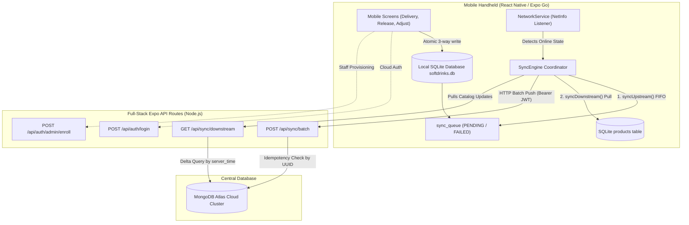

# 🔄 Phase 3: Background Synchronization Engine & Cloud Authentication

## Executive Summary

Phase 3 establishes the **bi-directional synchronization bridge** connecting the offline SQLite database on warehouse mobile devices with the centralized **MongoDB Atlas** cloud cluster. It also delivers **hybrid cloud + offline authentication**, **NetInfo reactive connectivity monitoring**, and **in-app staff enrollment**.

---

## 1. Architectural Overview



---

## 2. Core Components Built in Phase 3

### 2.1 HTTP Client & Interceptors ([`mobile/src/client/api/client.ts`](file:///D:/softdrinks-app/softdrinks-inventory-system/mobile/src/client/api/client.ts))
- Configured Axios singleton targeting dynamic `API_BASE_URL`.
- **Request Interceptor**: Automatically reads JWT from `expo-secure-store` (`session_token`) and injects `Authorization: Bearer <token>` into outgoing requests.
- **Timeout Protection**: Enforces 15,000ms request timeout limit to prevent hanging background threads.

### 2.2 Network Connectivity Detector ([`mobile/src/client/services/networkService.ts`](file:///D:/softdrinks-app/softdrinks-inventory-system/mobile/src/client/services/networkService.ts))
- Subscribes to `@react-native-community/netinfo` to capture real-time connectivity transitions.
- **Zero Polling**: Does not ping or run timer loops. State is strictly event-driven.
- **Auto-Sync Hook**: When connectivity transitions from offline to online, immediately notifies `SyncContext` to execute `syncNow()`.

### 2.3 Synchronization Engine ([`mobile/src/client/services/syncEngine.ts`](file:///D:/softdrinks-app/softdrinks-inventory-system/mobile/src/client/services/syncEngine.ts))
1. **`syncUpstream()`**:
   - Queries SQLite `sync_queue` for records with status `PENDING` or `FAILED` ordered FIFO by `queued_at ASC`.
   - Limits batch payload to 100 transactions per HTTP transmission (NFR6).
   - Marks batch items as `SYNCING` to prevent parallel race conditions.
   - Posts payload to `POST /api/sync/batch`.
   - For all UUIDs acknowledged in `response.synced`: updates status to `SYNCED` and records `synced_at`.
   - For all UUIDs in `response.failed`: updates status to `FAILED`, increments `retry_count`, and stores `error_message`.
2. **`syncDownstream()`**:
   - Reads `last_downstream_sync_timestamp` from `SecureStore`.
   - Calls `GET /api/sync/downstream?since=<timestamp>`.
   - Upserts updated products and authoritative stock levels into local SQLite `products` table.
   - Cleanses legacy placeholder mock products.
   - Stores new `server_time` watermark in `SecureStore`.
3. **`syncAll()`**:
   - Orchestrates upstream push followed by downstream pull.
   - Triggers `InventoryContext.refresh()` to refresh in-memory product stock.

### 2.4 Hybrid Cloud + Offline Authentication ([`mobile/src/client/context/AuthContext.tsx`](file:///D:/softdrinks-app/softdrinks-inventory-system/mobile/src/client/context/AuthContext.tsx))
- **Online Path (FR2)**:
  1. Requests `POST /api/auth/login`.
  2. Saves signed JWT in `SecureStore`.
  3. Uses device-side bcrypt to hash password and upsert credentials into SQLite `users_cache`.
  4. Triggers background downstream catalog sync.
- **Offline Path (FR3)**:
  1. If offline or network unavailable, queries `users_cache` in local SQLite.
  2. Verifies password against cached bcrypt hash.
  3. Sets active user session locally.
- **React Native Hermes PRNG Polyfill ([`mobile/src/client/utils/crypto.ts`](file:///D:/softdrinks-app/softdrinks-inventory-system/mobile/src/client/utils/crypto.ts))**:
  - Polyfills `bcrypt.setRandomFallback()` using `expo-crypto`'s native random byte generator (`Crypto.getRandomValues`), ensuring bcrypt functions reliably on mobile devices.

### 2.5 Dynamic Host Address Resolution ([`mobile/src/client/utils/constants.ts`](file:///D:/softdrinks-app/softdrinks-inventory-system/mobile/src/client/utils/constants.ts))
- Dynamically extracts host machine LAN IP from `Constants.expoConfig?.hostUri`.
- Solves the physical device `localhost` limitation, enabling Android devices running Expo Go to reach the Node.js API routes over Wi-Fi without hardcoded manual configuration.

### 2.6 In-App Staff Management ([`mobile/src/app/(owner)/users/`](file:///D:/softdrinks-app/softdrinks-inventory-system/mobile/src/app/(owner)/users/))
- **Staff Enrollment (`enroll.tsx`)**: Form to provision new warehouse employees with temporary passwords.
- **Personnel Directory (`index.tsx`)**: Lists all registered accounts with role badges, status toggles (`Active`/`Inactive`), and password reset modal.
- Accessible via **Settings > OWNER CONTROLS** for accounts with role `owner/manager`.

---

## 3. Transaction Outbox State Machine

```
      [ Transaction Recorded ]
                 │
                 ▼
            ┌─────────┐
            │ PENDING │
            └────┬────┘
                 │ (Network Online & Sync Triggered)
                 ▼
            ┌─────────┐
            │ SYNCING │
            └────┬────┘
                 ├───────────────────────────────┐
                 ▼ (HTTP 200 & Server Ack)        ▼ (Server Reject / Net Error)
            ┌─────────┐                     ┌─────────┐
            │ SYNCED  │                     │ FAILED  │
            └─────────┘                     └────┬────┘
                                                 │ (Retry on next sync cycle)
                                                 └─────────► [ Back to SYNCING ]
```

---

## 4. Verification & Testing Evidence

1. **TypeScript Typecheck**:
   - `npx tsc --noEmit` passed with **0 errors**.
2. **Expo Diagnostics**:
   - `npx expo-doctor` passed **20/20 checks**.
3. **Live Atlas End-to-End Test Suite**:
   - `npm run test:api` passed **100% operational** across health check, login, product creation, batch sync idempotency, and replenishment reports.
4. **Physical Device Live Verification**:
   - Confirmed online login as `zach`.
   - Confirmed recording offline transaction in SQLite.
   - Confirmed error handling on invalid legacy product ID (`mock-prod-005` flagged FAILED with retries counter).
   - Confirmed successful upload and transition to `SYNCED` upon smart ID mapping and Atlas catalog hydration.
